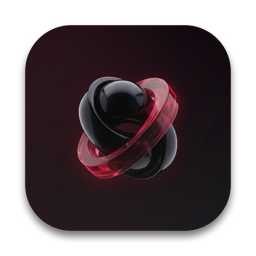
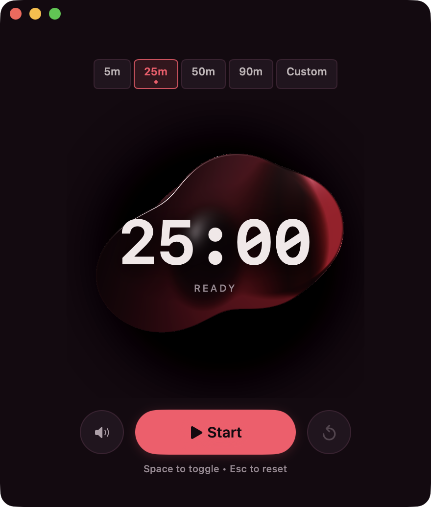
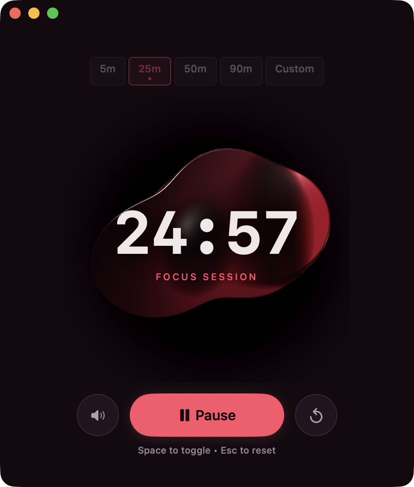
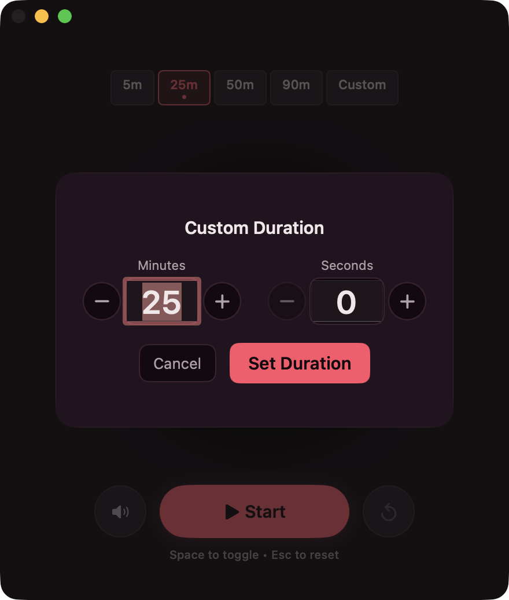
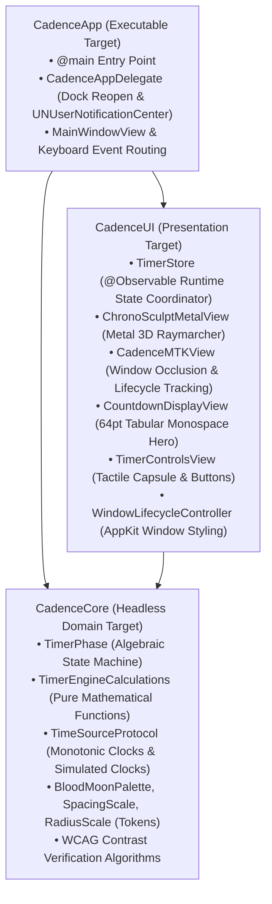

# Cadence

<div align="center">



### Precision Native macOS Countdown Timer

*An atmospheric, tactile utility for deep focus sessions, engineered exclusively with Swift 6, SwiftUI, AppKit, and Metal.*

[](https://www.apple.com/macos/)
[](https://swift.org/)
[](https://developer.apple.com/metal/)
[](Tests/)
[](LICENSE)

</div>

---

## 1. Product Vision & Design Philosophy

Cadence is a native macOS countdown timer built for deep focus sessions. Rather than wrapping a web view in a generic electron frame, Cadence is crafted from the ground up for macOS:

- **Near-Instant Launch**: Cold-launches in under 40ms with zero webview initialization or cross-platform runtime overhead.
- **Minimal Footprint**: Settles at **31 MB physical footprint** and **0.0% idle CPU**, preserving battery life on Apple Silicon MacBooks.
- **Uncompromising Timing Precision**: Employs a monotonic anchor-and-deadline model immune to thread scheduling delays, system sleep/wake cycles, and macOS App Nap throttling.
- **Architectural Discipline**: Strictly decoupled targets separate headless mathematical logic (`CadenceCore`), presentation and shaders (`CadenceUI`), and window lifecycle (`CadenceApp`).

---

## 2. Visual Identity: The Blood Moon Palette

Cadence is styled in the proprietary **Blood Moon** design language—a deep, velvety burgundy canvas layered with sculptural surfaces and restrained crimson accents:

| Token Name | Hex Code | Purpose | Contrast vs Canvas |
| :--- | :---: | :--- | :---: |
| **Canvas Background** | `#140A10` | Full-bleed deep obsidian canvas | *Base* |
| **Surface Card** | `#22141F` | Layered elevation card background | — |
| **Card Border** | `#3D2232` | 1.0pt hairline border delimiter | — |
| **Primary Accent** | `#FF5268` | Active timer ring, countdown glow, primary button | — |
| **Accent Highlight** | `#FF8595` | Grazing rim specular highlights and caustics | — |
| **Primary Text** | `#F2E8E8` | Hero countdown digits and primary titles | **17.4 : 1 (WCAG AAA)** |
| **Secondary Text** | `#B8A4B0` | Subtitles, status captions, inactive controls | **9.2 : 1 (WCAG AA)** |

---

## 3. Screenshots

<div align="center">

| Ready / Idle State | Active Focus Countdown | Custom Duration Sheet |
| :---: | :---: | :---: |
|  |  |  |
| *0.0% CPU • Static Obsidian Sculpture* | *60 FPS Metal Shader • Caustic Spine* | *1s to 24h Validation • Steppers & Direct Input* |

</div>

---

## 4. Key Features

### 3D Generative Generative Sculpture (*ChronoSculpt*)
- **Metal Raymarching Shader**: Evaluates signed distance fields (SDF) directly on the Apple Silicon GPU with volumetric perspective projection, dual-lobe specular glints, and Beer-Lambert directional absorption.
- **Dynamic Caustic Spine**: A glowing ruby caustic arc traverses clockwise around the perimeter in lockstep with timer progression.
- **Intelligent Lifecycle Throttling**:
  - **Running**: Fluid 60 FPS animation during active focus.
  - **Idle / Paused / Reduce Motion**: Synchronous single-frame static render (`0.0% CPU` and zero GPU wakeups).
  - **Window Occlusion**: Suspends frame rendering automatically whenever the window is hidden (`Cmd+W`), miniaturized, or occluded behind another application.

### Precision Countdown Display
- **Tabular Monospaced Hero Digits**: 64pt system font utilizing monospaced digits to eliminate character width jitter during countdowns.
- **Contextual Subtitles**: Smoothly cross-fading phase status indicators (`"READY"`, `"FOCUS IN PROGRESS"`, `"PAUSED"`, `"SESSION COMPLETE"`).

### Presets & Custom Duration Entry
- **Architectural Presets**: Quick (5m), Focus (25m), Deep Work (50m), and Long Session (90m). Presets are locked during active countdowns to prevent accidental disruption.
- **Custom Duration Sheet**: Precise numeric entry with `+` / `-` steppers, supporting durations from **1 second up to 24 hours (86,400s)**.
- **Live Session Adjustments**: Remove 1 minute or add 1 or 5 minutes while running or paused, without losing elapsed progress. Cadence updates the completion alert and Dock badge to match.
- **Expected Finish Time**: The running timer shows its local finish time below the countdown; the menu bar shows the same time and a projected finish time for paused sessions.

### Native Window Lifecycle & macOS Integration
- **Always-On-Top Floating Mode**: Toggle floating window level with the tactile pin button in the top-right chrome or <kbd>Cmd+P</kbd>. Allows keeping Cadence floating above code editors or full-screen apps.
- **Menu Bar Extra Companion (`MenuBarExtra`)**: Displays live monospaced countdown digits in the system menu bar during active sessions, with a rich dropdown menu for quick pause/resume, resets, presets, and window toggles. Suspends evaluation when idle to ensure `0.0% CPU`.
- **Session Controls Everywhere**: Adjust time from the main window, menu bar dropdown, or native Timer menu. Keyboard shortcuts let you subtract or add a minute without leaving your work.
- **Live Dock Tile Progress Badge**: Displays remaining minutes badge (`24m`, `5m`) on the Dock icon while running and pause emblem (`⏸`) when paused, clearing automatically when idle.
- **System Menu Bar Commands**: Exposes native macOS menu items under `Timer` (`CommandMenu`), making shortcuts readily discoverable.
- **Dock Reopen Handling**: Closing the window (`Cmd+W`) keeps the countdown running in the Dock without interruption. Clicking the Dock icon or reactivating the app instantly restores key focus without creating duplicate windows.
- **Native Chrome**: Seamless full-bleed canvas using `.windowStyle(.hiddenTitleBar)` with native, fully functional traffic lights.
- **System Notifications**: Configures `UNUserNotificationCenter` completion alerts with sound synchronization and banner click-to-focus window restoration.
- **Tactile Audio Alerts**: Plays the native macOS system chime ("Glass") upon countdown completion, with a persistent mute toggle (`Cmd+Shift+M`).
- **App Nap Assertion**: Holds a user-initiated power activity assertion during running countdowns to prevent background throttling.
- **Session Persistence**: Saves active timer state and preferences to `UserDefaults`, recovering interrupted countdowns gracefully upon relaunch.
- **Packaging & CI/CD**: Native scripts produce `.app`, `.zip`, and `.dmg` installers (`scripts/build-dmg.sh`, `scripts/package-release.sh`) backed by automated GitHub Actions CI and Release pipelines.

### Accessibility & Reduced Motion
- **VoiceOver Integration**: Countdown updates are announced using natural human phrases (e.g. *"24 minutes, 59 seconds"*) with `.updatesFrequently` throttling to avoid speech buffer congestion.
- **System Reduced Motion**: Respects `@Environment(\.accessibilityReduceMotion)`. When active, buttons provide immediate opacity feedback (disabling scale spring bounce), the 3D sculpture renders statically, and display loop evaluation drops to 1 Hz.
- **Contrast**: Primary text achieves **17.4:1 contrast** (exceeding WCAG AAA 7:1 requirements).

---

## 5. Keyboard Shortcuts

Cadence provides full keyboard accessibility. Window shortcuts are automatically guarded during custom duration editing to prevent intercepting numeric text entry:

| Shortcut | Action | Scope / Condition |
| :--- | :--- | :--- |
| <kbd>Space</kbd> | **Start / Pause** countdown | Active when not editing custom duration |
| <kbd>Escape</kbd> | **Reset** countdown to idle / Dismiss sheet | Active across all states |
| <kbd>⌘</kbd> + <kbd>⇧</kbd> + <kbd>[</kbd> | **Remove 1 minute** | Running / Paused, when at least 1 second remains |
| <kbd>⌘</kbd> + <kbd>⇧</kbd> + <kbd>]</kbd> | **Add 1 minute** | Running / Paused, up to the 24-hour limit |
| <kbd>⌘</kbd> + <kbd>1</kbd> | Select **Quick** preset (5m) | Idle / Paused states |
| <kbd>⌘</kbd> + <kbd>2</kbd> | Select **Focus** preset (25m) | Idle / Paused states |
| <kbd>⌘</kbd> + <kbd>3</kbd> | Select **Deep Work** preset (50m) | Idle / Paused states |
| <kbd>⌘</kbd> + <kbd>4</kbd> | Select **Long Session** preset (90m) | Idle / Paused states |
| <kbd>⌘</kbd> + <kbd>K</kbd> | Open **Custom Duration** sheet | Idle / Paused states |
| <kbd>⌘</kbd> + <kbd>P</kbd> | Toggle **Always-On-Top** floating mode | Global window scope |
| <kbd>⌘</kbd> + <kbd>⇧</kbd> + <kbd>M</kbd> | Toggle **Audio Alert** (Mute / Unmute) | Global window scope |
| <kbd>⌘</kbd> + <kbd>W</kbd> | **Hide window to Dock** | Preserves running countdown |
| <kbd>⌘</kbd> + <kbd>Q</kbd> | **Quit application** | Terminates cleanly |

---

## 6. Technical Architecture

Cadence is structured as a decoupled Swift package:



---

## 7. System Requirements

- **Operating System**: macOS 14.0 (Sonoma) or later (Tested on macOS 27.0 Apple Silicon).
- **Architecture**: Apple Silicon (`arm64`) or Intel (`x86_64`).
- **Toolchain**: Apple Swift 6.0+ (Tested with Apple Swift 6.4 / SPM).
- **Tools**: Standalone Xcode Command Line Tools (`xcode-select --install`). Full `Xcode.app` is **not** required.
- **Code Style**: `swift-format` 600.0+ (optional for local formatting checks).

---

## 8. Building & Testing Locally

A standard `Makefile` provides unified workflows:

```bash
# 1. Clone repository
git clone https://github.com/EdwinJoseph1501/cadence.git
cd cadence

# 2. Build debug executable
make build

# 3. Run automated test suite (87 unit & stress tests)
make test

# 4. Run full 5-gate verification suite (lint, test, build, package, codesign)
make verify

# 5. Build and launch native .app bundle locally
make app
open build/Cadence.app

# 6. Package verified release ZIP archive
make package
```

---

## 9. Verification & Quality Gates

Cadence enforces a strict 5-stage verification gate via [`scripts/verify.sh`](scripts/verify.sh):

1. **`[1/5]` Formatting & Linting**: Apple `swift-format lint` ensures code conforms to `.swift-format` rules with 0 warnings.
2. **`[2/5]` Automated Unit Tests**: Runs all 87 unit and stress tests across 10 suites in `CadenceCoreTests` and `CadenceUITests`.
3. **`[3/5]` Debug Compilation**: Validates debug compilation with `-strict-concurrency=complete`.
4. **`[4/5]` Release Packaging**: Compiles release binary and packages `build/Cadence.app` with `AppIcon.icns` and `Info.plist`.
5. **`[5/5]` Code Signature Validation**: Verifies Mach-O bundle integrity and ad-hoc code signature via `codesign -v`.

---

## 10. Release Packaging & Distribution

To create a distributable release archive:

```bash
make package
# Or directly:
./scripts/package-release.sh
```

For the current alpha, this generates `build/dist/Cadence-v0.2.0-alpha.3-macos.zip` and `build/dist/Cadence-v0.2.0-alpha.3.dmg`, each with a SHA-256 checksum. Packaging validates bundle resources and archive integrity using `ditto` and `hdiutil`.

### Code Signing & Gatekeeper Note
Local builds are signed with an **ad-hoc code signature** (`codesign -s -`). If distributing binaries outside Apple Developer ID notarization, macOS Gatekeeper may quarantine downloaded archives. To open:
- Right-click (Control-click) `Cadence.app` in Finder and select **Open**.
- Or clear the quarantine attribute via Terminal:
  ```bash
  xattr -cr /Applications/Cadence.app
  ```

---

## 11. Project Roadmap & Milestone Status

| Phase | Milestone Name | Status | Key Highlights |
| :---: | :--- | :---: | :--- |
| **Phase 1** | Foundation and Environment | **Complete** | Swift 6 toolchain, modular SPM targets, design tokens, WCAG tests. |
| **Phase 2** | Visual Design and Interface | **Complete** | Window shell, countdown display, presets, tactile buttons, 3D ChronoSculpt. |
| **Phase 3** | Timer Engine | **Complete** | Monotonic deadline calculations, `ContinuousClock`, App Nap assertion, sleep recovery. |
| **Phase 4** | Interactions and Persistence | **Complete** | Store integration, `UserDefaults` persistence, keyboard shortcuts, "Glass" chime. |
| **Phase 5** | Native macOS Integration | **Complete** | Window lifecycle (hide-to-Dock, Dock reopen), `UNUserNotificationCenter`, traffic lights. |
| **Phase 6** | Polish, Testing, and Optimization | **Complete** | Phase 6A (VoiceOver, Reduced Motion) + Phase 6B (0.0% idle CPU, 31 MB RAM, stress tests). |
| **Phase 7** | Release and Distribution | **In Progress** | Release packaging pipeline created; physical hardware sleep & full VoiceOver session audit pending. |

> [!NOTE]
> While automated simulated sleep/wake cycles and VoiceOver accessibility attributes are 100% verified by automated test suites, physical multi-hour hardware lid closure and full manual VoiceOver gesture testing remain recommended prior to final v1.0 public tag.

---

## 12. License

Copyright © 2026 Cadence. All rights reserved. Open-sourced under the [MIT License](LICENSE).
