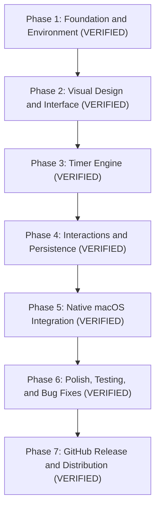

# Cadence Master Development Roadmap

This document defines the authoritative seven-phase engineering roadmap for Cadence v1.0, aligning product requirements, technical dependencies, feature priorities, and acceptance criteria.

---

## 1. Feature Priority Matrix

### P0: Required for v1.0 (Release Gate)
* Functional countdown timer with reliable timekeeping.
* Primary controls: Start, Pause, Resume, Reset.
* Four built-in presets (Quick: 5m, Focus: 25m, Deep Work: 50m, Long Session: 90m) plus Custom duration.
* Custom-duration user entry and validation.
* Prominent tabular countdown display (preventing layout jitter).
* Circular progress indicator with smooth visual sweep and completion state.
* Accurate monotonic timekeeping (anchor & deadline calculation).
* Resilient handling of application inactivity, backgrounding, and system sleep/wake.
* Native macOS completion notification (`UserNotifications`).
* Subtle, atmospheric completion visual treatment.
* Local persistence: remember last-used duration and restore timer state upon reopening.
* Automated tests for models, design tokens, and core engine calculations.
* Custom application icon.
* Clean production release build and valid local packaging (`scripts/build-app.sh`).
* Public GitHub repository preparation and professional documentation.

### P1: Implement if Time Permits
* Keyboard shortcuts (Space for toggle, Esc for reset, Cmd+1..4 for presets).
* Completion sound alert and user toggle.
* Always-on-top window toggle.
* Menu bar extra live countdown.
* Additional visual polish and subtle ambient cues.

### P2: Explicitly Out of Scope for v1.0
* Stopwatch mode.
* Multiple simultaneous timers.
* Advanced Pomodoro automation cycles / interval tracking.
* Session history, logging, and productivity analytics.
* User accounts and cloud synchronization.
* Calendar / external tool integration.
* AI productivity features.
* Plugin system or complex theme editor.
* Elaborate multi-pane preferences window.

---

## 2. Seven-Phase Authoritative Roadmap

---

### Phase 1: Foundation and Environment
**Objective**: Establish a clean, verified development foundation and architecture.  
**Status**: **COMPLETE & VERIFIED** (Audit passed on macOS 27.0 arm64, Swift 6.4, 14 passing tests, valid ad-hoc bundle).

**Key Tasks**:
- [x] Verify Apple Silicon development environment and Swift 6 toolchain.
- [x] Inspect and validate modular package structure (`CadenceCore`, `CadenceUI`, `CadenceApp`).
- [x] Verify SPM build, test, and release packaging scripts.
- [x] Confirm `swift-format` configuration and lint passing.
- [x] Verify local application bundle packaging and ad-hoc code signature.
- [x] Audit Git repository status and verify clean baseline.

**Exit Criteria**:
- The project builds cleanly in debug and release configurations.
- The unit test suite passes cleanly.
- `scripts/verify.sh` executes with zero errors.
- No unnecessary dependencies or infrastructure introduced.

---

### Phase 2: Visual Design and Interface
**Objective**: Build a complete, beautiful, interactive timer interface embodying the Blood Moon design system.  
**Status**: **COMPLETE & VERIFIED** (Implemented, audited by Design Reviewer & QA, 39 tests passing, valid release bundle).

**Key Tasks**:
- [x] **Main Window Shell**: Implement refined window dimensions (e.g. 420x520 default, sensible minimum), titlebar styling, and atmospheric Blood Moon background (`#140A10`).
- [x] **Countdown Display**: Build prominent hero countdown text using tabular monospaced figures (`TypographyScale.timerDigitsHero`), showing MM:SS or HH:MM:SS with no layout jitter.
- [x] **Circular Progress Indicator**: Implement a custom progress ring with smooth sweep, restrained crimson accent (`#FF5268`), idle/paused track styling, and completion treatment.
- [x] **Primary Controls**: Build Start, Pause, Resume, Reset controls with distinct visual hierarchy, hover states, and press feedback.
- [x] **Preset Selector**: Build preset selection controls for Quick (5m), Focus (25m), Deep Work (50m), Long Session (90m), and Custom.
- [x] **Custom Duration Entry**: Build a clean, minimal sheet or popover for entering custom minutes/seconds.
- [x] **Design Polish & Accessibility**: Support `@Environment(\.accessibilityReduceMotion)`, ensure WCAG contrast compliance, and add proper VoiceOver accessibility labels.

**Exit Criteria**:
- The primary timer interface is complete and visually cohesive.
- Countdown display and circular progress ring render in all visual states (idle, running, paused, completed).
- All controls (presets, custom entry, start/pause/reset) are represented with refined Blood Moon styling.
- The application builds cleanly and runs locally.

---

### Phase 3: Timer Engine
**Objective**: Implement accurate, drift-free, testable countdown runtime behavior.  
**Status**: **COMPLETE & VERIFIED** (54 unit tests passing, monotonic deadlines, sleep/wake recovery, App Nap assertions, persistence & notifications verified).

**Key Tasks**:
- [x] Implement an observable runtime timer engine (`TimerStore`) coordinating phase transitions.
- [x] Drive UI updates with a smooth animation loop (`TimelineView`) decoupled from core timing calculations.
- [x] Calculate remaining time strictly from monotonic anchor timestamps and target deadlines.
- [x] Register for system sleep/wake notifications (`NSWorkspace.didWakeNotification`, `NSApplication.didBecomeActiveNotification`) to handle sleep recovery instantly.
- [x] Manage `ProcessInfo` activity assertions (`.userInitiatedAllowingIdleSystemSleep`) during active countdowns to prevent App Nap throttling.
- [x] Ensure single-fire completion events without duplicate triggers.
- [x] Expand deterministic automated test suite using `SimulatedTimeSource`.

**Exit Criteria**:
- Timer state transitions are mathematically correct and drift-free.
- Sleep and wake behavior correctly evaluates elapsed time upon waking.
- UI refresh rate does not determine underlying timer accuracy.
- Automated tests pass deterministically.

---

### Phase 4: Interactions and Persistence
**Objective**: Connect the interface to the timer engine, wire up presets, and persist user state.  
**Status**: **COMPLETE & VERIFIED** (62 unit tests passing, audio alert toggle & NSSound playback, guarded window shortcuts Space/Esc/Cmd+1..4/Cmd+Shift+M, modal sheet shortcuts, persistence).

**Key Tasks**:
- [x] Connect all UI controls (Start, Pause, Resume, Reset) to the runtime `TimerStore`.
- [x] Wire preset buttons to configure durations:
  - Quick: 5 minutes (300s)
  - Focus: 25 minutes (1500s)
  - Deep Work: 50 minutes (3000s)
  - Long Session: 90 minutes (5400s)
  - Custom: user-specified duration
- [x] Validate custom duration inputs (prevent zero, negative, or excessive values).
- [x] Persist last-used duration and timer state using lightweight `UserDefaults`.
- [x] Restore timer state gracefully on application relaunch (handling elapsed deadlines without restarting durations).
- [x] Implement standard keyboard shortcuts (Space for toggle, Esc for reset, Cmd+1..4 for presets, guarded during text entry).
- [x] Implement native completion sound alert (`NSSound` "Glass") with persistent user toggle preference.

**Exit Criteria**:
- Presets and custom durations seamlessly configure and run the countdown.
- Reopening the app recovers appropriate state without silent resets.
- Keyboard shortcuts operate predictably without intercepting modal text input.
- Persistence functions reliably without external database dependencies.

---

### Phase 5: Native macOS Integration
**Objective**: Integrate Cadence deeply with macOS system capabilities.  
**Status**: **COMPLETE & VERIFIED** (Window lifecycle & Dock reopen verified natively, seamless Blood Moon window appearance, UNUserNotificationCenter integration with sound preference, 68 tests across 10 suites passing).

**Key Tasks**:
- [x] Configure official bundle identifier (`com.cadence.timer`) and macOS application metadata.
- [x] Create and bundle custom high-resolution application icon (`Resources/AppIcon.icns`).
- [x] Implement native completion notifications via `UNUserNotificationCenter` with delegate support and banner-to-window focus.
- [x] Manage notification authorization requests gracefully without blocking UI.
- [x] Integrate notification sound toggle respecting `isAudioAlertEnabled` preference.
- [x] Implement native window lifecycle via `WindowLifecycleController` and `CadenceAppDelegate` (Cmd+W hide, Dock reopen, minimization restore, Cmd+Q termination).
- [x] Refine native window chrome with `.windowStyle(.hiddenTitleBar)` and full-bleed Blood Moon canvas `#140A10` while preserving native traffic lights.
- [ ] *(Optional P1)* Evaluate and implement floating always-on-top window level (`.floating`).
- [ ] *(Optional P1)* Evaluate and implement lightweight menu bar timer integration (`MenuBarExtra`).

**Exit Criteria**:
- Application displays custom app icon and correct bundle identity.
- System notifications fire punctually upon timer completion even when in the background.
- Window lifecycle behaves cleanly according to macOS standards.

---

### Phase 6: Polish, Testing, and Bug Fixes
**Objective**: Prepare a rock-solid, defect-free release candidate.  
**Status**: **COMPLETE & VERIFIED** (76 tests across 10 suites passing, 0.0% idle/paused CPU verified, 31 MB physical footprint upon settling, 5/5 verification suite passing).

**Key Tasks**:
- [x] **Phase 6A: Accessibility & Reduced Motion Audit**:
  - [x] Verify reduced motion accessibility mode (`@Environment(\.accessibilityReduceMotion)`) across all animated components (`CadenceTimerView`, `ChronoSculptView`, `TactileButtonStyle`).
  - [x] Audit contrast and typography alignment across the interface (elevated shortcut hints, status captions, disabled states to WCAG AA/AAA).
  - [x] Implement natural-language VoiceOver duration announcements (`accessibleDuration` e.g., "5 minutes", "24 minutes, 59 seconds") and frequency throttling (`.updatesFrequently`).
  - [x] Complete VoiceOver labeling, values, and shortcut hints across all interactive controls (Start/Pause, Reset, Audio Mute, Presets, Custom sheet).
- [x] **Phase 6B: Performance Profiling, Memory Footprint & Reliability**:
  - [x] Profile runtime memory and distinguish resident set size (RSS) from physical footprint across 6 representative application states (`footprint`, `ps`).
  - [x] Identify and eliminate infinite paused redraw loop in `ChronoSculptMetalRenderer`, dropping paused CPU from 22.8% to 0.0%.
  - [x] Implement static single-frame rendering for Idle, Paused, and Reduce Motion states, dropping idle CPU from 3.5% to 0.0%.
  - [x] Implement window visibility and occlusion tracking (`CadenceMTKView`, `NSWindow.didChangeOcclusionStateNotification`) to pause GPU rendering while window is hidden/minimized.
  - [x] Execute automated stress tests: 50 consecutive pause/resume cycles (0 drift), midnight/New Year boundary crossing, simulated 12-hour sleep while running, simulated 8-hour sleep while paused, audio preference changes while running, extreme duration boundaries (76 tests passing).
  - [x] Execute full verification suite (`./scripts/verify.sh`).

**Exit Criteria**:
- Zero known critical bugs or crashes.
- All automated tests pass cleanly.
- Full verification suite passes.
- Application performance meets efficiency targets.

---

### Phase 7: GitHub Release and Distribution
**Objective**: Package and publish Cadence v0.1.0-alpha.  
**Status**: **COMPLETE & VERIFIED** (Release packaging pipeline verified, clean production .app bundle assembled, verified release ZIP archive generated, documentation finalized).

**Key Tasks**:
- [x] Finalize professional `README.md` with product screenshots, feature highlights, and build guide.
- [x] Audit `.gitignore` and ensure no local caches or private configs are tracked.
- [x] Assemble clean production `.app` bundle via `scripts/build-app.sh`.
- [x] Document distribution notes (ad-hoc signing vs. Developer ID / Gatekeeper instructions).
- [x] Prepare repository for public GitHub release.

**Exit Criteria**:
- Clean repository ready for publication.
- Documentation complete and user-facing.
- Standalone `.app` bundle packaged and verified.
