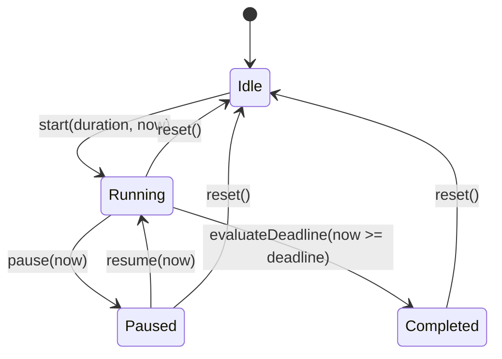

# Cadence Timer Engine Architecture

This document specifies the architectural model, mathematical foundation, and system integration strategy for the Cadence timer engine.

---

## 1. Core Problem: The Failure of Naive Timers

Most amateur timer applications suffer from subtle but critical inaccuracies due to naive tick loops (e.g., executing `setInterval` or `Timer.scheduledTimer(withTimeInterval: 1.0)` and decrementing an integer count: `remainingSeconds -= 1`).

### Why Naive Timers Fail on macOS:
1. **Clock Drift Accumulation**: Operating system timers are not real-time guarantees; timers fire slightly late due to thread scheduling. A 5ms delay per second accumulates to 18 seconds of drift over a single hour.
2. **System Sleep / Lid Closure**: When a MacBook lid is closed or macOS enters sleep, CPU execution is suspended. A decremented timer completely freezes while the machine sleeps, resuming upon wake as if no time has passed.
3. **macOS App Nap & Power Throttling**: macOS aggressively coalesces and throttles timers for inactive or background windows to conserve battery, causing ticks to fire at unpredictable 5–30 second intervals.
4. **UI Thread Contention**: If window resizing, heavy animations, or main thread tasks occur, timer tick firings are delayed, causing jerky countdowns or missed seconds.

---

## 2. The Anchor & Deadline Model

Cadence eliminates timer drift entirely by adopting a **monotonic time anchor & target deadline architecture**.

### Mathematical Foundation

Rather than mutating state on every clock tick, the state of a running timer is defined by immutable parameters:
- `totalDuration: TimeInterval` (e.g. 1500 seconds)
- `targetDeadline: Date` (the exact wall-clock instant when the countdown reaches zero)
- `anchorContinuousTime: ContinuousClock.Instant` (monotonic clock reference immune to system clock adjustments)

At any arbitrary instant `t`, the exact remaining duration is computed via a pure function:

$$\text{remaining}(t) = \max(0, \text{targetDeadline} - t)$$

$$\text{progress}(t) = \min\left(1.0, \max\left(0.0, \frac{\text{totalDuration} - \text{remaining}(t)}{\text{totalDuration}}\right)\right)$$

### Key Properties:
- **Zero Drift**: Whether a tick arrives early, late, or skips 5 seconds during system sleep, the calculation always yields the mathematically correct remaining time.
- **Instant Wake Recovery**: When the Mac awakens from a 2-hour sleep, the very first tick evaluates `targetDeadline < now`, immediately transitioning to the completed state and firing alarms.

---

## 3. Explicit State Machine

The timer engine lifecycle is modeled as an algebraic enum (`TimerPhase` in `CadenceCore`):



### State Definitions

1. **`.idle`**:
   No active countdown. The display shows the configured duration or preset value.
2. **`.running(targetDeadline: Date, totalDuration: TimeInterval)`**:
   An active countdown is in progress. The application holds a background activity assertion (`ProcessInfo`) to prevent sleep throttling.
3. **`.paused(remainingDuration: TimeInterval, totalDuration: TimeInterval)`**:
   The countdown is frozen. The remaining duration is locked in as a static value. Resuming computes a new deadline: `newDeadline = now + remainingDuration`.
4. **`.completed(completedAt: Date, totalDuration: TimeInterval)`**:
   The deadline has passed. Completion audio and notification alerts are dispatched.

---

## 4. Separation of UI Cadence from Domain Correctness

UI animations (e.g., the smooth circular sweep of the progress ring and digit updates) are completely decoupled from domain timekeeping:

```
┌────────────────────────────────────────────────────────┐
│                   Domain Layer                         │
│   (Target Deadline: Date & Continuous Clock Anchor)    │
└───────────────────────────┬────────────────────────────┘
                            │ Pure Query: remaining(at: now)
                            ▼
┌────────────────────────────────────────────────────────┐
│                    UI Layer                            │
│   TimelineView(.animation) or CADisplayLink (60/120Hz) │
│   Smooth progress ring interpolation                   │
│   Sub-pixel tabular digit refresh                      │
└────────────────────────────────────────────────────────┘
```

- If the UI frame rate drops (e.g. during heavy system load), the countdown does not slow down.
- If the UI is hidden or minimized, UI rendering halts completely, consuming 0% GPU, while the domain deadline remains perfectly intact.

---

## 5. System Sleep, Wake & App Nap Handling

### Sleep & Wake Notifications
Cadence registers for system wake broadcasts via `NSWorkspace`:
- `NSWorkspace.didWakeNotification`
- `NSWorkspace.screensDidWakeNotification`

When macOS wakes, the engine immediately calls `evaluateDeadline(at: Date.now)`. If the target deadline elapsed while the machine slept, the timer transitions to `.completed` immediately.

### App Nap Assertion
While in the `.running` state, Cadence holds an activity assertion using `ProcessInfo`:
```swift
let activity = ProcessInfo.processInfo.beginActivity(
    options: [.userInitiated, .idleSystemSleepDisabled],
    reason: "Cadence Active Countdown Timer"
)
```
This informs the macOS kernel that the application is performing an active user-initiated task, preventing App Nap from freezing background scheduling.

---

## 6. System Notifications & Sound Alerts

When a timer starts, Cadence does not rely solely on the application remaining open in memory to alert the user.

### Two-Tier Notification Strategy:
1. **System Notification Trigger (`UNUserNotificationCenter`)**:
   Upon entering `.running`, an exact `UNNotificationRequest` is scheduled with a `UNTimeIntervalNotificationTrigger` matching the remaining seconds.
   *Even if the user closes the main window, the macOS Notification Center will punctually deliver the banner and audio notification at the deadline.*
2. **Active Foreground Alert**:
   If Cadence is in the foreground when the deadline hits, it plays a native system sound (`NSSound` or custom audio asset), triggers a gentle visual pulse on the window, and dismisses the pending system banner to avoid redundant noise.
3. **Cancellation on Pause/Reset**:
   Pausing or resetting immediately calls `UNUserNotificationCenter.current().removePendingNotificationRequests(withIdentifiers: [timerId])`.

---

## 7. Deterministic Testing Strategy

Testing real-time timers with `sleep(seconds)` is brittle, slow, and non-deterministic.

Cadence abstracts the time source behind `TimeSourceProtocol`:
```swift
public protocol TimeSourceProtocol: Sendable {
    var now: Date { get }
}
```

In production, `SystemTimeSource` provides `Date.now`.
In unit tests, `SimulatedTimeSource` allows test cases to:
- Instantly advance time by 1500 seconds without waiting.
- Simulate an unexpected 3-hour computer sleep jump.
- Verify pause and resume calculations with microsecond precision.
- Test edge cases (e.g., zero duration, negative intervals) deterministically in under 1 millisecond.
